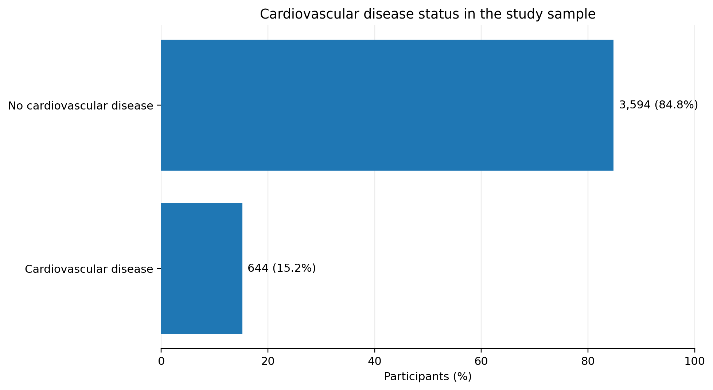

# Cardiovascular Disease Risk Factors: Statistical Modelling

## Project overview
A collaborative STAT305 Biostatistics Methods project at the University of KwaZulu-Natal. The study explored factors associated with cardiovascular disease (CVD) using survey data from 4,238 participants.

## Research question
Which demographic, behavioural and medical characteristics are associated with whether a participant developed CVD?

## Data
The report describes 4,238 participants and variables including gender, age, education, cigarettes smoked per day, blood-pressure medication, previous stroke, systolic blood pressure, diastolic blood pressure and CVD status.

## Methods used
- Frequency tables for categorical variables
- Descriptive statistics for quantitative variables
- Tests of association between categorical predictors and CVD
- Logistic regression using SAS
- Model reduction and comparison using Akaike Information Criterion (AIC)
- Goodness-of-fit assessment and predicted probabilities

## Selected findings reported
- 644 of 4,238 participants (15.2%) were recorded as having CVD.
- The report compared a full logistic regression model with reduced models.
- The reduced model reported in the SAS code used gender, prevalent stroke, age and systolic blood pressure.

## Tools
- SAS
- Statistical analysis and logistic regression

## My contribution
This was a group university assignment. I was listed as a member of Group N. I am presenting it here as collaborative academic work, not as a solo project.

## Limitations and notes
This repository currently documents the analysis described in the group report. The original dataset and complete executable SAS project files have not yet been added. The report's findings are associations in the analysed sample and should not be interpreted as proof of causation or as a clinical diagnostic tool.

## Planned repository contents
- `README.md` — project overview and methods
- `code/` — SAS scripts, once checked and added
- `report/` — a public-safe, permission-cleared report or selected extracts, if appropriate
- `figures/` — charts recreated from the analysis, if available

## Results: Cardiovascular Disease Distribution

The study included 4,238 participants. Of these, 644 (15.2%) had cardiovascular disease, while 3,594 (84.8%) did not.

## Key Findings

- 4,238 participants were included in the analysis.
- 644 participants (15.2%) had cardiovascular disease.
- 3,594 participants (84.8%) did not have cardiovascular disease.
- Logistic regression was used to investigate factors associated with cardiovascular disease.
